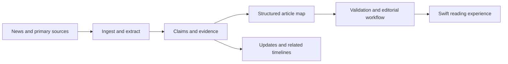

# Gyeol · 결

**An evidence-linked reading system for articles and research.**

Gyeol explores how an AI-assisted reading experience can retain the connection between a generated narrative and its underlying sources. This public snapshot brings together a Python ingestion and editorial backend, a Swift reading client, and selected website source.



## Inside the project

- **Ingestion and mapping:** source collection, extraction, retrieval and structured article generation.
- **Evidence and validation:** source-linked claims, editorial models, validation and revision-related logic.
- **Reading experience:** `ArticleFeedKit` models and rendering support, plus SwiftUI application source.
- **Operations and integrations:** backend code for editorial workflows, authentication and optional provider integrations.

## Repository guide

| Path | Purpose |
| --- | --- |
| `server/app/` | FastAPI service, pipeline, models and integrations |
| `server/tests/` | Selected tests and synthetic fixtures |
| `ios/ArticleFeedKit/` | Swift package for feed, article maps and discovery |
| `ios/TextShortsApp/` | SwiftUI application source and Xcode project |
| `website/` | Selected public-site source and package metadata |

## Explore and test

The backend's Python dependencies and example settings are provided for local development:

```bash
cd server
python -m venv .venv
source .venv/bin/activate
pip install -r requirements.txt -r requirements-dev.txt
cp .env.example .env
pytest -q tests/test_claim_diff.py tests/test_map_output_schemas.py
```

Run the Swift package tests with Xcode and Swift 6 or newer:

```bash
cd ios/ArticleFeedKit
swift test
```

The selected Python tests and Swift package tests run without connecting to production services. A working deployment additionally requires your own database, providers, secrets, domain, and operational configuration.

## Public snapshot boundaries

This is a sanitized source snapshot, not a turnkey copy of the production system. Deployment-specific settings, signing identities, credentials, operational records, original datasets, generated assets, and some integration tests are excluded. Existing service URLs are replaced with non-working examples. The SwiftUI application and website source may require omitted images, fonts, build/hosting configuration, and account-specific settings before they can be built or deployed. Review all configuration and third-party rights before reusing or deploying them. Natural Earth map data is included with its attribution and public-domain notice.
